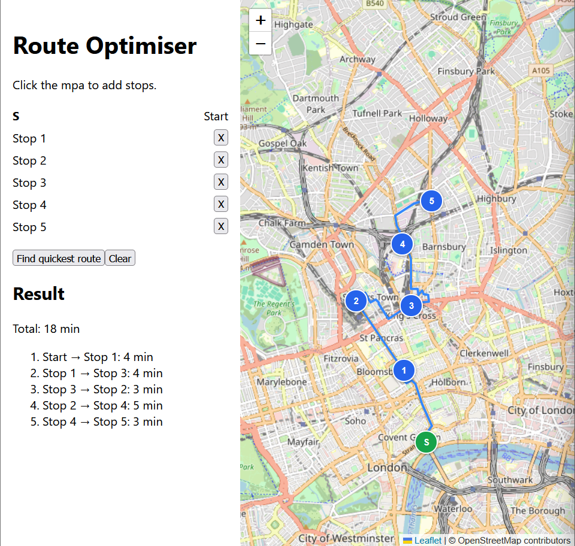

# Route Optimiser

A REST API and web front end that takes a start point and a list of destinations and returns a quick order for visiting all of them by road, drawn along the actual roads on a map. Driving times come from [OSRM](https://project-osrm.org/) (Open Source Routing Machine), and the ordering is computed by this project's own solvers.



Built with Java, Spring Boot (embedded Tomcat) and Docker, with a React + TypeScript front end (Vite, Leaflet).

## How it works

1. A client sends a start point and a list of destinations.
2. The service asks OSRM's `/table` endpoint for the driving time between every pair of points.
3. A solver finds a visiting order: nearest neighbour builds an initial path, then 2-opt improves it.
4. The service asks OSRM's `/route` endpoint for the road geometry through the stops in that order.
T5he API returns the ordered stops, the duration of each leg and the total and the road geometry.

The result is an *open path*: it begins at the start point and ends at the last stop, without returning to the start.

```
Client -> RouteController -> RouteOptimisationService -> RoutingClient -> OSRM /table, /route
                                      |
                                      +-> RouteSolver (nearest neighbour + 2-opt)
```

## Quick start

**Prerequisites:**

- Docker with Compose v2 (on Windows, Docker Desktop must be running)
- A bash shell: any Linux or macOS terminal, WSL, or [Git Bash](https://git-scm.com/downloads) on Windows

```bash
git clone https://github.com/Lmatt05/route-optimiser.git
cd route-optimiser

# 1. Download and process a map (needs approximately 3 GB of RAM available to Docker. Default map requires approx 400MB - Greater London UK)
./scripts/prepare-osrm.sh

# 2. Start OSRM and the API
docker compose up --build

# 3. Start the front end (in a second terminal; needs Node.js 20.19+ or 22.12+)
cd frontend
npm install
npm run dev
```

On Windows, run both commands from Git Bash rather than PowerShell or Command Prompt. If the script isn't executable, run `bash scripts/prepare-osrm.sh` instead.

Check it is running:

```bash
curl http://localhost:8080/actuator/health
```

Open http://localhost:5173 and click the mpa to set a start point and add stops.

The default map is Greater London. To use another region, pass its [Geofabrik](https://download.geofabrik.de/) path, for example `./scripts/prepare-osrm.sh europe/germany/berlin`. The script also saves the region's bounding box to a git-ignored `.env` file, so the API tells the front end which area to show and the map limits itself to the loaded region automatically.
## API

### `POST /api/v1/routes/optimise`

Request:

```json
{
  "start": { "label": "Depot", "latitude": 51.5074, "longitude": -0.1278 },
  "destinations": [
    { "label": "A", "latitude": 51.5155, "longitude": -0.0922 },
    { "label": "B", "latitude": 51.5033, "longitude": -0.1195 }
  ]
}
```

| Field | Required | Notes |
|---|---|---|
| `start` | yes | where the route begins |
| `destinations` | yes | at least one stop |
| `latitude` | yes | -90 to 90 |
| `longitude` | yes | -180 to 180 |
| `label` | no | up to 100 characters, echoed back in the response |

Example call:

```bash
curl -s -X POST http://localhost:8080/api/v1/routes/optimise \
  -H "Content-Type: application/json" \
  -d '{"start":{"label":"Depot","latitude":51.5074,"longitude":-0.1278},"destinations":[{"label":"A","latitude":51.5155,"longitude":-0.0922},{"label":"B","latitude":51.5033,"longitude":-0.1195}]}'
```

(In IntelliJ you can also run `requests/optimise.http` directly.)

Response:

```json
{
  "stops": [
    {
      "label": "Depot",
      "latitude": 51.5074,
      "longitude": -0.1278
    },
    {
      "label": "B",
      "latitude": 51.5033,
      "longitude": -0.1195
    },
    {
      "label": "A",
      "latitude": 51.5155,
      "longitude": -0.0922
    }
  ],
  "legs": [
    {
      "fromIndex": 0,
      "toIndex": 1,
      "durationSeconds": 304.1
    },
    {
      "fromIndex": 1,
      "toIndex": 2,
      "durationSeconds": 449.0
    }
  ],
  "totalDurationSeconds": 753.1,
  "geometry": [[-0.12781, 51.50739], [-0.12774, 51.50751], [-0.12768, 51.50763]]
}
```

`stops` is in visiting order, starting with the start point. Each leg's `fromIndex` and `toIndex` are positions in that array, and durations are in seconds. `geometry` is the route along the roads, as `[longitude, latitude]` pairs (GeoJSON order). If the road geometry can't be fetched, the route is still returned with `"geometry": []` and clients can fall back to straight lines between stops.
### Errors

| Status | When |
|---|---|
| 400 | invalid or missing fields, malformed JSON, no destinations, too many stops |
| 422 | the points cannot be connected by road |
| 502 | the routing service (OSRM) is unavailable or returned an unusable response |
| 500 | unexpected internal error |

Error bodies look like:

```json
{
  "status": 400,
  "error": "Bad Request",
  "message": "Request validation failed",
  "details": [
    "start.latitude: must be greater than or equal to -90.0"
  ]
}
```

### `GET /api/v1/map/bounds`

Returns the bound box of the map loaded into OSRM, which the front end uses to restrict what is shows:

```json
{ "south": 51.28, "west": -0.52, "north": 51.7, "east": 0.34 }
```

## Configuration

| Setting | Environment variable | Default | Purpose |
|---|---|---|---|
| `osrm.base-url` | `OSRM_BASE_URL` | `http://localhost:5000` | where OSRM is reachable |
| `osrm.timeout` | `OSRM_TIMEOUT` | `5s` | connect and read timeout for OSRM |
| `route.max-stops` | `ROUTE_MAXSTOPS` | `50` | maximum stops including the start (keep at or below OSRM's table limit of 100) |
| `map.bounds.south` | `MAP_BOUNDS_SOUTH` | `51.28` | southern edge of the loaded map (latitude) |
| `map.bounds.west` | `MAP_BOUNDS_WEST` | `-0.52` | western edge (longitude) |
| `map.bounds.north` | `MAP_BOUNDS_NORTH` | `51.70` | northern edge (latitude) |
| `map.bounds.east` | `MAP_BOUNDS_EAST` | `0.34` | eastern edge (longitude) |

`prepare-osrm.sh` sets the `MAP_BOUNDS_*` values for you in `.env` (read by Docker Compose), so you only need to set them by hand if you prepare map data some other way.

## Design decisions

- **`/table` plus my own solver, rather than OSRM's `/trip`.** OSRM can solve a similar problem server-side. Doing the ordering here keeps the algorithm visible, testable and swappable behind the `RouteSolver` interface.
- **Heuristic, not exact.** Finding the optimal order is NP-hard. Nearest neighbour followed by 2-opt gives good routes quickly, but doesn't guarantee the optimal route.
- **Open path and asymmetric times.** The route doesn't return to the start, and driving time from A to B can differ from B to A (one-way streets). The 2-opt implementation handles both.
- **Ports and adapters.** `domain` has no framework imports. `RoutingClient` and `RouteSolver` are interfaces, so the service is tested with stubs and no network.
- **Validation in layers.** The API layer checks request shape and coordinate ranges. The domain objects enforce their own invariants. The service enforces the stop limit.
- **Geometry is a separate, optional call.** The order is solved from `/table` times, then OSRM `/route` is called once for the final order to get road geometry. If that call fails, the route is returned without geometry rather than failing the request, since the ordering is still valid.
- **Map bounds come from the extract, not the code.** The preparation script reads the region's boundary from Geofabrik's `.poly` file and the API exposes it, so switching region needs no front-end change.

## Limitations

- Driving profile only, with no live traffic or time-of-day effects.
- OSRM snaps each point to the nearest road, so a point in a park or river can be routed from somewhere slightly different.
- Results are heuristic and not guaranteed to be the shortest possible.
- The API snaps coordinates outside the loaded map to the nearest point in it. The front end avoids this by limiting the map to the loaded area.
- The map bounds are a rectangle around the region, so irregular regions include some area with no data. Regions crossing the antimeridian (180° longitude) aren't supported.
- Without road geometry (if OSRM's `/route` call fails), the front end draws straight lines between stops.
## Development

```bash
mvn test                      # run the unit tests

docker compose up osrm        # run only OSRM...
mvn spring-boot:run           # ...and the API from your machine (default base URL is localhost:5000)

cd frontend && npm run dev    # front end with hot reload; proxies /api to localhost:8080
```

On Windows, run these from Git Bash too, so the commands behave the same as on Linux and macOS.

### Project structure

| Package | Responsibility |
|---|---|
| `api` | controllers (`RouteController`, `MapController`), request and response DTOs, error handling |
| `domain` | `Coordinate`, `Stop`, `DurationMatrix`, `Route`, `RouteLeg`, domain exceptions |
| `service` | `RouteOptimisationService` orchestrates matrix, solver and route building |
| `solver` | `RouteSolver`, `NearestNeighbourSolver`, `TwoOptSolver` |
| `routing` | `RoutingClient` interface and the OSRM implementation |
| `config` | configuration properties (route, OSRM, map bounds) and bean wiring |

the front end is in frontend/src:
| Folder | Responsibility |
|---|---|
| `api` | typed `fetch` wrappers for the API |
| `components` | `MapView` (Leaflet map, markers, route line) |
| `hooks` | `useMapBounds` (loads the map area from the API) |
| `types` | TypeScript types mirroring the API's JSON |

## Possible improvements

- Or-opt moves to complement 2-opt
- Caching repeated matrix requests
- GitHub Actions CI
- Serving the frond end from Docker so a single 'docker compose up' runs everything
- Address search for adding stops

## Data

Map data is from OpenStreetMap, © OpenStreetMap contributors, available under the [ODbL](https://www.openstreetmap.org/copyright), and downloaded via [Geofabrik](https://download.geofabrik.de/).
The front end draws map tiles from OpenStreetMap's public tile servers (© OpenStreetMap contributors). Their usage policy is meant for light use, so use a different tile provider if you deploy this publicly.